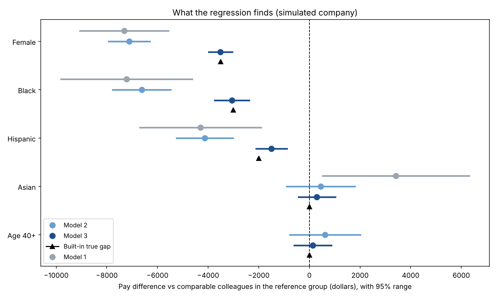
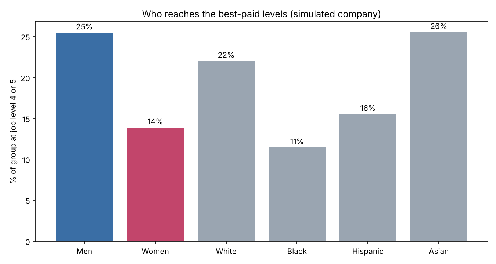

# Pay Equity Regression: Simulated Company Example

**Everything in this example is simulated.** No real company or person is involved. I created 2,000 fictional employees and built known pay gaps into the pay formula, so we can check that the regression finds them. Real engagements use a client's confidential HR data.

**The scenario:** a company asks, "Do we pay women, or employees of a given race or ethnicity, less than comparable colleagues?"

| Notebook | Script | Data |
|---|---|---|
| [Pay Equity Simulated Example.ipynb](Pay%20Equity%20Simulated%20Example.ipynb) (also as [HTML](Pay%20Equity%20Simulated%20Example.html)) | [simple_pay_equity_regression.py](simple_pay_equity_regression.py) | [simulated_company_pay_data.csv](simulated_company_pay_data.csv) (simulated) |

## The model

Multiple linear regression (often called multivariate regression in HR work), in plain dollars:

```
Pay = b0 + b1·Female + b2·Black + b3·Hispanic + b4·Asian + b5·Age40Plus
         + b6·Experience + b7·Tenure + b8·Education + location + department + job level + error
```

| Role | Variables |
|---|---|
| **Dependent variable** (what we explain) | `Pay`, annual pay in dollars |
| **Protected characteristics** (what we test) | Female, Black, Hispanic, Asian (reference group: White), Age 40+ |
| **Legitimate job-related controls** | Experience, tenure, education, location (cost tier), department |
| **Contested control** | Job level (1 to 5) |

Each b is a **slope**: how many dollars pay changes when that variable goes up by one, holding the others equal. For a 0/1 flag like `Female`, that slope is the pay gap between the two groups.

**Built-in "truth" (known only because I simulated the data):** women -$3,500, Black employees -$3,000, Hispanic employees -$2,000, Asian employees $0, age 40+ $0, all at the same job level and with all else equal.

## Three models, adding one block at a time



| Group | Model 1 (raw) | Model 2 (+ job factors) | Model 3 (+ job level) | Built-in truth |
|---|---|---|---|---|
| Female | -$7,314 | -$7,111 | **-$3,511** | -$3,500 |
| Black | -$7,220 | -$6,618 | **-$3,061** | -$3,000 |
| Hispanic | -$4,299 | -$4,130 | **-$1,497** | -$2,000 |
| Asian | +$3,419 | +$453 (not sig.) | +$296 (not sig.) | $0 |
| Age 40+ | not in model | +$623 (not sig.) | +$129 (not sig.) | $0 |
| R-squared | 0.06 | 0.80 | 0.94 | |

Model 3 recovers the built-in gaps. All Model 3 ranges contain the true values (Hispanic: -$2,110 to -$884 contains -$2,000).

## How to read one result

Take Model 3, Female: **-$3,511, 95% range -$3,973 to -$3,049, p < 0.001.**

- **Coefficient (-$3,511):** a woman is paid about $3,500 less than a comparable man (same experience, tenure, education, location, department and job level).
- **95% range:** the true gap very likely lies between about $3,050 and $3,970. The range doesn't contain 0.
- **p-value:** below 0.05, so statistically significant. Chance alone is an unlikely explanation.
- **Not significant:** Asian (+$296, range -$426 to +$1,019) and Age 40+ (+$129). Their ranges contain 0, so we can't tell them from chance.
- **R-squared 0.94:** the model explains about 94% of pay differences.

## Two lessons for an interview

**1. Raw gaps and adjusted gaps differ.** The raw gap for women is about $7,300. At the same job level it is about $3,500. The difference comes from women reaching senior levels less often:



**2. Job level is a judgment call.** Model 2 (without job level) shows the *total* gap, about $7,100 for women, including the effect of fewer women reaching senior levels. Model 3 shows the gap *between people at the same level*. A consultant reports both, because controlling for level can make pay look fairer than the system is if the barrier is in promotion.

## Real-world examples to cite

- **Salesforce** runs a pay assessment each year (seven since 2015) covering nearly 70,000 employees across gender and race/ethnicity. In its latest reported assessment, 8.5% of employees needed pay adjustments, at a cost of $5.6 million, with more than $22 million spent cumulatively since 2015. [Salesforce, 2022 equal pay update](https://www.salesforce.com/news/stories/2022-equal-pay-update-the-salesforce-approach-to-pay-fairness/)
- **Glassdoor**, using more than 505,000 salaries, found men earn 24.1% more in base pay on average. Comparing workers with the same job title, employer and location, the gap falls to 5.4%. [Glassdoor, "Demystifying the Gender Pay Gap"](https://www.glassdoor.com/blog/gender-pay-gap/)
- **Blau and Kahn (2017, NBER)** studied U.S. panel data from 1980 to 2010 and found that by 2010 conventional human capital variables explained little of the gender wage gap, while occupation and industry segregation remained important. [NBER working paper 21913](https://www.nber.org/papers/w21913)

## Limits to say out loud

- The data is simulated, so the results show the method works, not that any real company has these gaps.
- The model assumes each group's gap is the same at every level. A real audit would test interactions and run models by job family.
- Gender here is binary and race has four groups, which is simpler than real data.
- Regression shows association, not proof of discrimination.

## 60-second interview version

> "I built a simulated company of 2,000 employees with known pay gaps, then ran a multiple regression of pay on gender, race/ethnicity, age and job-related controls. The raw gap for women was about $7,300. Controlling for experience, tenure, education, location and department barely moved it, but adding job level cut it to about $3,500, which matched the gap I'd built in. That showed me two things: the method recovers real gaps, and job level is a judgment call, because part of the problem was women reaching senior levels less often. I'd report both versions to a client."

## Run it yourself

```bash
pip install pandas numpy matplotlib statsmodels
python simple_pay_equity_regression.py     # or open the notebook / run cell by cell in Spyder
```

The script generates the simulated data (fixed random seed, so results repeat), saves `simulated_company_pay_data.csv`, and writes two charts to `images/`.
